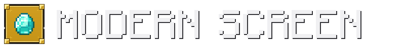
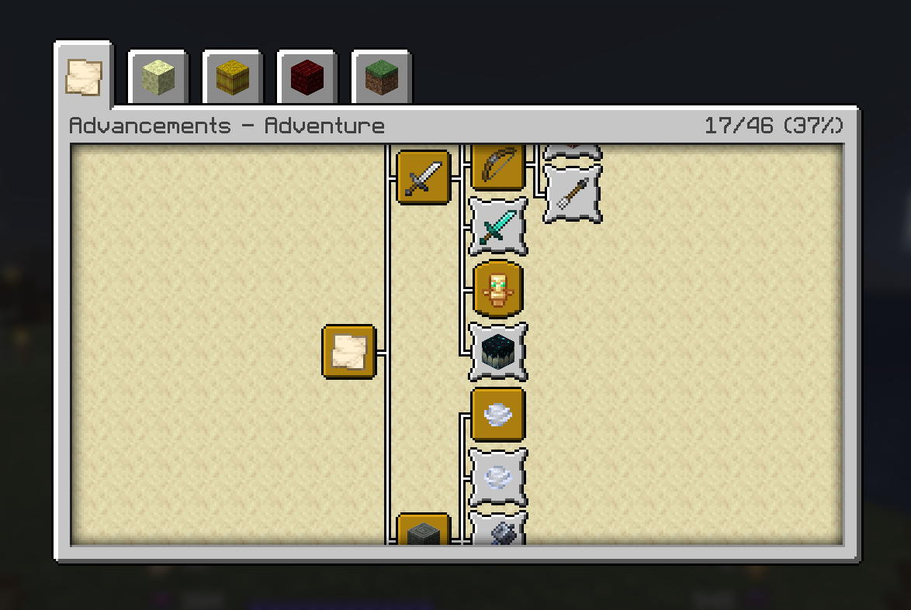
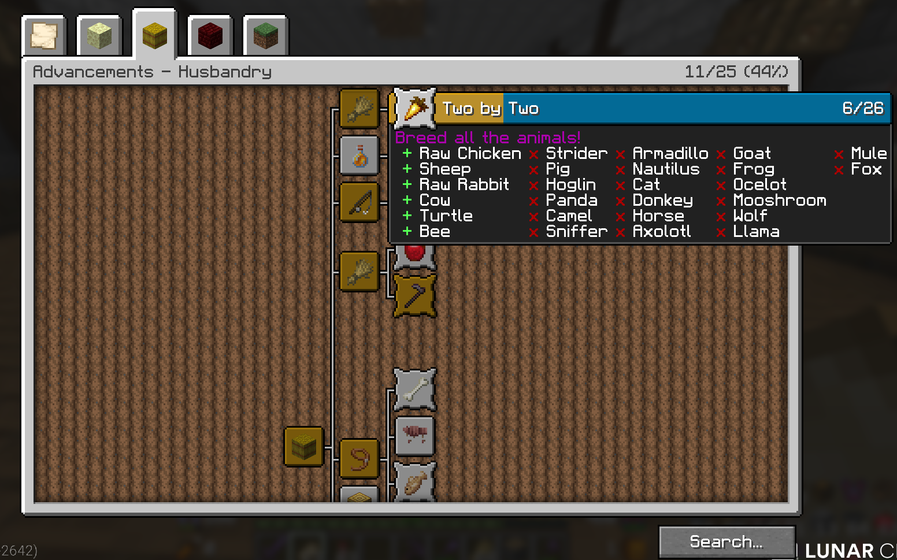
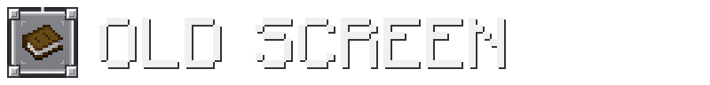
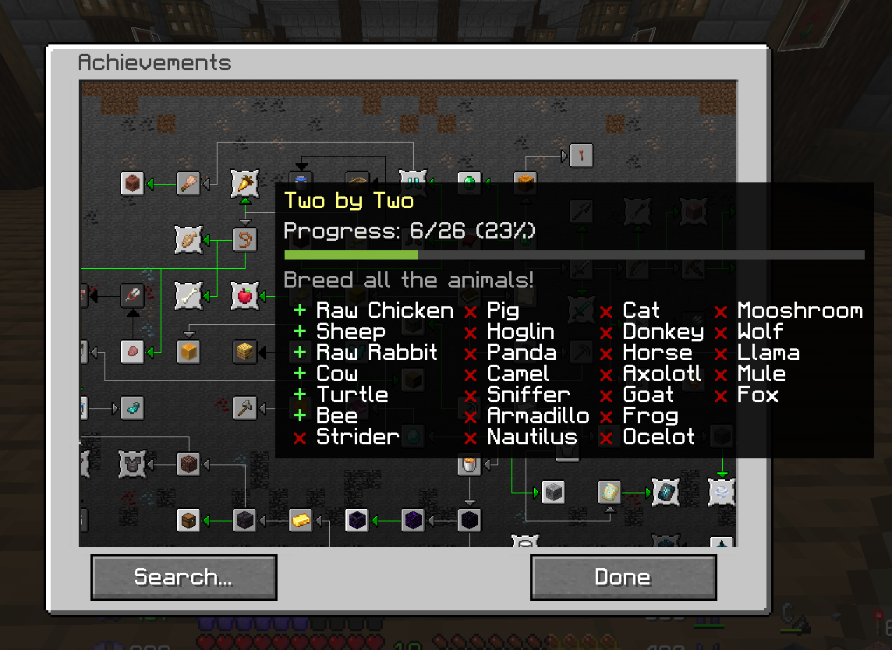
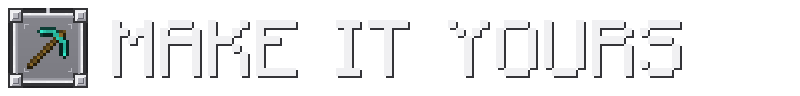
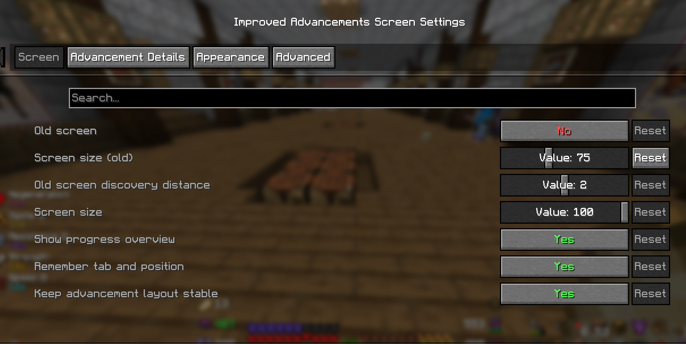

# Improved Advancements Screen

> Every requirement. Every milestone. A little nostalgia.

**Minecraft 26.3 · Fabric · Client-side**

Track progress with **counts and percentages**, return to your saved tab and map position, and keep advancement layouts consistent.

Find your next goal by **name, description, or item**. Press **Ctrl+F** and select a result to jump to it. Search works in both views.

See completed and remaining requirements in advancement tooltips, where Minecraft provides that information. **Completed requirements come first, with missing ones at the end.**

Enable **Old screen** for an achievement map inspired by Minecraft before 1.12.

Explore modern advancements on **one draggable map**, with an underground background, prerequisite arrows, and nearby goals that appear as you progress.

Zoom with the mouse wheel and return to your saved position and zoom. Optional tooltips show **progress, a progress bar, and remaining requirements**.

Configure your preferred view, discovery distance, progress display, tooltips, and appearance through **Mod Menu**.

Enable Old screen through **Mods → Improved Advancements Screen → Configure → Screen**.

Install with **Fabric API**. Add **Mod Menu** and **Cloth Config** for configuration.

Minecraft still controls advancement completion and which requirement details reach your client.

---

Modified by **periklis20M** and **JohnFG**. Based on [Better Advancements](https://modrinth.com/mod/better-advancements) by **way2muchnoise**, under its original [license](https://github.com/perikIis20M/improved-advancements-screen/blob/main/LICENSE.md).

[Source code & issues](https://github.com/perikIis20M/improved-advancements-screen)

Classic Minecraft artwork belongs to Mojang. Unofficial project; not affiliated with Mojang or Microsoft.
